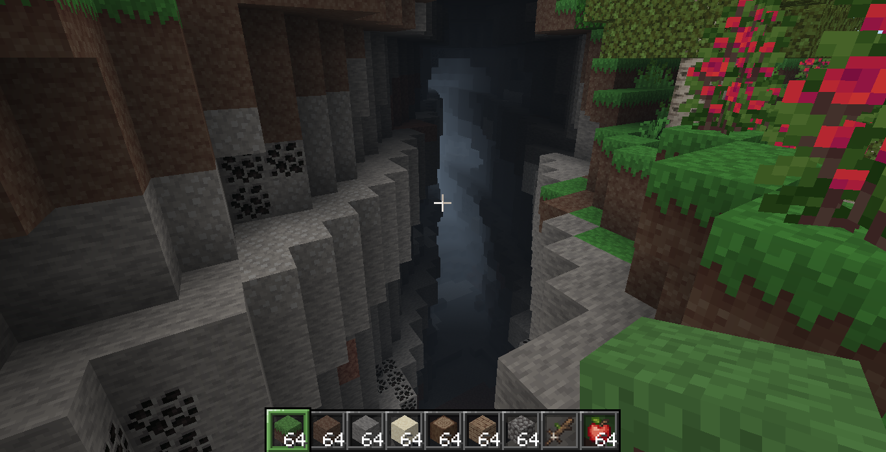
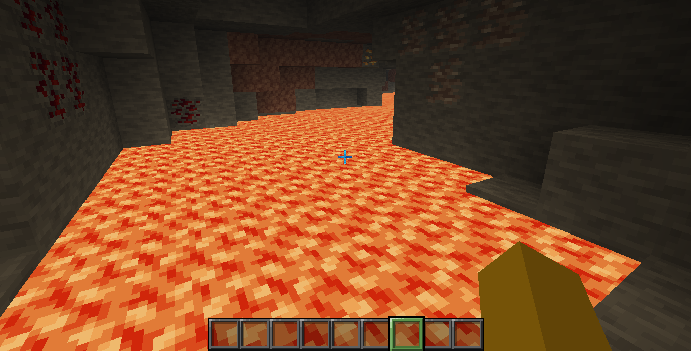
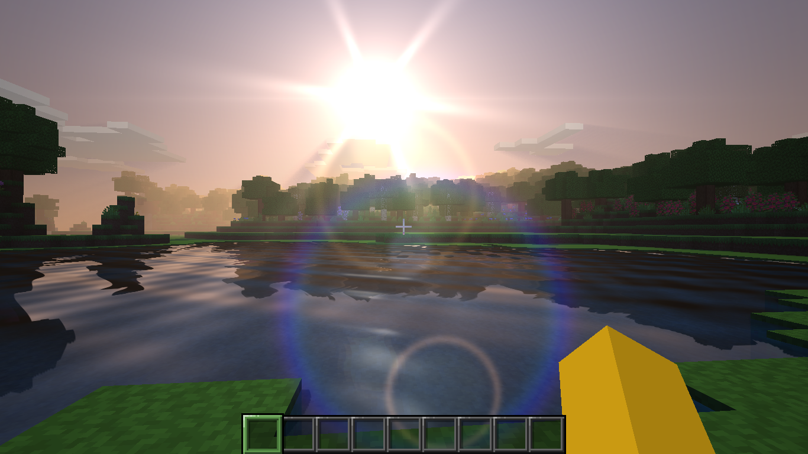

# Blockland

Blockland é um jogo voxel escrito em C++17. O projeto inclui geração de terreno, construção e mineração de blocos, inventário, crafting, ciclo de dia e noite e um modo multiplayer experimental por UDP.

O código usa SDL2 para janela e entrada e OpenGL para renderização. A organização atual mantém os módulos em arquivos `.inc` incluídos por `src/main.cpp`; a compilação não usa CMake.

O jogo toma como referência algumas mecânicas e interfaces do Minecraft Java 1.8.9 e do inventário criativo da versão 1.12.2. Blockland é um projeto independente, não oficial e sem afiliação com Mojang ou Microsoft.

## Capturas de tela

As imagens abaixo estão na pasta `doc/` do repositório.







## Requisitos

No Linux, instale:

- um compilador C++ com suporte a C++17, como `g++`;
- SDL2 e seus arquivos de desenvolvimento;
- OpenGL e os arquivos de desenvolvimento;
- `bash` e `sdl2-config`.

Em distribuições baseadas em Debian ou Ubuntu:

```bash
sudo apt update
sudo apt install build-essential libsdl2-dev libgl-dev
```

No Arch Linux ou derivados:

```bash
sudo pacman -S --needed base-devel sdl2
```

No Fedora:

```bash
sudo dnf install gcc-c++ SDL2-devel mesa-libGL-devel
```

O script também contém uma configuração para MSYS2 MinGW64 no Windows. Nesse ambiente, mantenha `SDL2.dll` e a pasta `assets/` ao lado do executável ao distribuir o jogo.

## Compilar e iniciar

Clone o repositório e entre na pasta do projeto:

```bash
git clone <URL-DO-REPOSITORIO>
cd Blockland
chmod +x build.sh
./build.sh
```

No Linux, o resultado é `./blockland`. No MSYS2/MinGW64, o script gera `blockland.exe`.

Para iniciar no Linux:

```bash
./blockland
```

Execute o jogo a partir da pasta do projeto para que os caminhos relativos de `assets/`, `mods/` e dos arquivos de configuração sejam encontrados.

## Controles

| Tecla ou entrada | Ação |
|---|---|
| `W`, `A`, `S`, `D` | Mover |
| `Espaço` | Pular; no criativo, dois toques ativam o voo |
| `Shift` | Agachar |
| `Ctrl` | Correr |
| `E` | Abrir ou fechar o inventário |
| `F3` | Mostrar ou ocultar informações de depuração |
| `F4` | Alternar entre criativo e sobrevivência |
| `F5` | Alternar perspectiva da câmera |
| `F6` | Alternar visualização dos braços |
| `F7` | Alternar sombras |
| `F8` | Ativar ou desativar o HUD para toque |
| `T` ou `/` | Abrir o chat |
| `Esc` | Fechar a tela atual ou abrir o menu de pausa |
| `Q` | Soltar um item |
| `Ctrl` + `Q` | Soltar uma pilha de itens |
| Botão esquerdo | Minerar ou atacar |
| Botão direito | Colocar blocos e interagir com blocos ou estações |

No inventário, as teclas `1` a `9` selecionam slots. Algumas ações de arrastar, dividir e transferir pilhas usam os botões do mouse e modificadores de teclado.

### HUD para toque

Pressione `F8` para exibir os controles na tela. As setas controlam o movimento; arrastar muda a direção da visão. O botão de pulo também permite subir no voo criativo, e o controle central alterna o agachamento ou desce durante o voo. Os botões superiores dão acesso à câmera, ao chat e à pausa. O botão `...` próximo da hotbar abre o inventário.

## O que está implementado

### Mundo e renderização

O mundo é dividido em chunks e usa geração procedural. Entre os biomas implementados estão planície, floresta, deserto, savana, selva, pântano, taiga, tundra e montanhas. O gerador também inclui árvores, lagos, minérios, masmorras e vilas; algumas peças das vilas ainda têm conteúdo simplificado.

O ciclo de dia e noite dura 24.000 ticks, cerca de 20 minutos em tempo real. O jogo desenha sol, lua, estrelas, nuvens, céu e neblina. O sistema de iluminação inclui luz do céu, luz de blocos emissores, suavização por vértice e oclusão ambiente.

A água tem fontes, níveis de fluxo, quedas e atualização por eventos. A correnteza pode afetar o movimento do jogador. A física usa caixas de colisão e inclui comportamentos para degraus, agachamento e água. O comportamento ainda pode diferir do Minecraft.

### Sobrevivência e criativo

No modo sobrevivência, é possível minerar blocos, coletar drops, usar a hotbar, organizar itens e fabricar receitas implementadas no projeto. O inventário oferece uma grade de crafting 2×2; a mesa de trabalho abre a grade 3×3.

O modo criativo tem categorias, busca e rolagem. A organização das abas segue a disposição do Minecraft 1.12.2, com uma aba adicional para itens encontrados no resource pack. A lista de itens e receitas é limitada ao conteúdo implementado no código e nos recursos carregados.

### Multiplayer

O multiplayer usa UDP e está em desenvolvimento. Por padrão, a primeira instância inicia o host na porta `47777`; uma segunda instância tenta entrar em `127.0.0.1`.

As opções de inicialização documentadas são:

```bash
# Jogar sem rede
./blockland --solo

# Conectar a outro computador
./blockland --join 192.168.1.20

# Escolher a porta
./blockland --port 47777
```

Para conectar pela rede local, inicie o host e use o endereço IP dele na opção `--join`. O firewall pode precisar permitir tráfego UDP na porta usada. O protocolo não deve ser tratado como seguro para redes públicas.

## Resource packs, texturas e skins

As texturas de blocos e itens são carregadas do diretório `assets/resourcepacks/`. O pack incluído é `Ashen_16x.zip`. O carregador suporta os formatos que o projeto implementa; outros packs do Minecraft podem não funcionar integralmente.

A organização principal de recursos é:

```text
assets/
├── creative/       # Categorias e itens do inventário criativo
├── resourcepacks/  # Packs de texturas
├── skins/          # Skins
├── textures/       # Texturas da interface, inventário e colormaps
└── ui/             # Configuração da interface
```

Para alterar as categorias do criativo, edite `assets/creative/mc-1.12.2.cfg`. O arquivo pode ser gerado novamente com:

```bash
python3 tools/gen_creative_1122.py
```

Antes de regenerar, guarde uma cópia de alterações manuais. As instruções de recursos também estão em `assets/resourcepacks/README.md`, `assets/textures/README.md` e `assets/ui/README.md`.

## Mods

Cada pasta de mod em `mods/` pode conter um arquivo `mod.txt`, que define uma aba no inventário criativo. Texturas opcionais ficam na pasta `textures/` do mod. O projeto aceita até 136 blocos e itens somados entre os mods. Consulte `mods/README.md` e o exemplo incluído para ver o formato esperado.

## Chat e comandos

Abra o chat com `T` ou `/`. Entre os comandos disponíveis estão:

| Comando | Ação |
|---|---|
| `/gamemode 0` ou `/gm 0` | Sobrevivência |
| `/gamemode 1` ou `/gm 1` | Criativo |
| `/give <item> [qtd]` | Adicionar item ao inventário |
| `/tp x y z` | Teleportar para coordenadas; aceita `~` para coordenadas relativas |
| `/clear` | Limpar o inventário |
| `/pos` | Mostrar a posição |
| `/cls` | Limpar a área visível do chat |
| `/ajuda` | Mostrar ajuda |
| `/locate <bioma\|vila>` | Procurar bioma ou vila |
| `/time set day\|noon\|sunset\|night\|midnight\|sunrise\|<ticks>` | Definir o horário |
| `/time add <n>` | Avançar o horário |
| `/time query` | Consultar o horário |
| `/time pause` | Pausar o ciclo de tempo |
| `/time resume` | Retomar o ciclo de tempo |

O horário do mundo é salvo em `level.cfg`. A disponibilidade de comandos pode mudar entre versões; `/ajuda` mostra a ajuda disponível no jogo.

## Estrutura do repositório

```text
.
├── assets/          # Resource packs, texturas, skins e configurações
├── mods/            # Mods e exemplo de estrutura
├── saves/           # Mundos salvos
├── src/             # Código C++ e módulos .inc
├── tests/           # Testes e stubs para SDL/OpenGL
├── tools/           # Ferramentas auxiliares
├── build.sh         # Compilação Linux e MSYS2/MinGW64
├── build-linux.sh   # Script de compilação Linux
├── build-windows.sh # Script de compilação Windows
├── build-android.sh # Script relacionado ao build Android
└── make-appimage.sh # Geração de AppImage
```

`src/main.cpp` é o ponto de entrada. Os arquivos `.inc` são incluídos por ele. Alguns módulos principais:

- `world.inc`, `worldgen.inc` e `blockupdate.inc`: blocos, chunks, geração e atualização do mundo.
- `physics.inc` e `main_loop.inc`: física, entrada, câmera e loop principal.
- `player_render.inc`, `entmodels.inc` e `render_items.inc`: modelos e renderização.
- `inventory_ui.inc`, `screens.inc` e `pause_menu.inc`: inventário, telas e pausa.
- `net.inc` e `netlan.inc`: comunicação em rede.
- `asset_manager.inc`, `mcpack.inc`, `png.inc` e `assets_atlas.inc`: carregamento de recursos.
- `mobs.inc`, `boat.inc`, `minecart.inc`, `bow.inc` e `pvp.inc`: entidades e mecânicas associadas.

A descrição mais detalhada dos módulos fica em `src/README.md`.

## Testes

O diretório `tests/` contém testes de lógica e verificações que usam stubs para as APIs SDL/OpenGL. Execute:

```bash
chmod +x tests/run.sh
./tests/run.sh
```

Os stubs servem para compilar e testar partes do código sem instalar a SDL2 de desenvolvimento; eles não substituem as bibliotecas necessárias para executar o jogo. Se um teste falhar, registre o comando, o sistema operacional e a saída do terminal.

## Problemas comuns

**`sdl2-config` não foi encontrado:** instale o pacote de desenvolvimento da SDL2 e confira se o comando está no `PATH`.

**Erro ao compilar por falta de cabeçalhos:** confirme que os pacotes de desenvolvimento de SDL2 e OpenGL estão instalados.

**Texturas ausentes:** execute o binário a partir da pasta do projeto e confira se `assets/resourcepacks/Ashen_16x.zip` existe e pode ser lido.

**Falha ao conectar no multiplayer:** confirme o IP, a porta e as regras do firewall. Para testar no mesmo computador, use a configuração padrão ou conecte a `127.0.0.1`.

**Problemas gráficos:** registre o modelo da GPU, a versão do driver e os dados exibidos pelo `F3` para ajudar a reproduzir o problema.

## Estado atual

O projeto está em desenvolvimento. O multiplayer é experimental, algumas estruturas geradas são simplificadas e a compatibilidade com resource packs depende dos formatos suportados pelo carregador. Itens, receitas, entidades e interações não cobrem todo o conteúdo do Minecraft. O comportamento de física e renderização também pode variar conforme o hardware e os drivers.

## Contribuir

Antes de propor uma mudança grande, abra uma issue para discutir o escopo. Para enviar uma alteração:

1. Faça um fork e crie uma branch para a mudança.
2. Mantenha o pull request focado em um problema ou melhoria.
3. Inclua passos para reproduzir bugs e testes quando possível.
4. Execute `./build.sh` e `./tests/run.sh` no ambiente disponível.
5. Atualize a documentação se os comandos, controles ou requisitos mudarem.

Relatos de bugs devem incluir sistema operacional, compilador, passos para reproduzir, resultado esperado e resultado observado. Logs e capturas de tela ajudam quando mostram o problema diretamente.

## Licença e créditos

Adicione um arquivo `LICENSE` antes de publicar o repositório e defina a licença do código. Confira também as licenças dos recursos de terceiros. A presença de um resource pack, textura ou skin no diretório do projeto não significa, por si só, que sua redistribuição esteja autorizada.

Minecraft é propriedade de seus respectivos titulares. Blockland é um projeto independente e não oficial. Mantenha os créditos e avisos exigidos pelos autores dos recursos utilizados.
